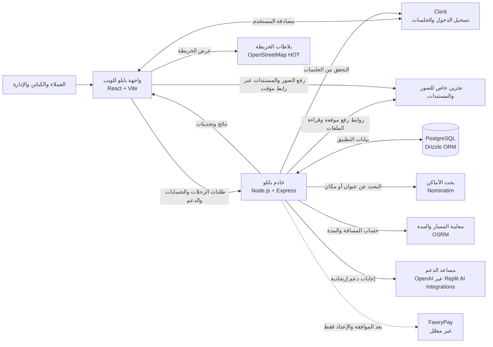

# مخطط بنية تطبيق بابلو

يوضح المخطط مكونات بابلو الحالية واتصالها. يميّز النص أسفل المخطط بين الخدمات المستخدمة فعليًا والخدمات التي لم تُفعّل بعد.

  
  
  

## مكونات التطبيق

- **واجهة بابلو:** واجهة ويب عربية يستخدمها العميل والكابتن والإدارة بحسب صلاحيات الحساب.
- **خادم API:** يدير الطلبات والحسابات والرسائل والدعم ويتحقق من المصادقة.
- **قاعدة البيانات:** PostgreSQL، ويتعامل معها الخادم عبر Drizzle ORM.
- **الصور والمستندات:** تُرفع إلى تخزين خاص باستخدام روابط رفع مؤقتة؛ لا تُضمّن في قاعدة البيانات نفسها.
- **المواقع والخرائط:** يعرض الموقع بلاطات OpenStreetMap، ويستخدم Nominatim للبحث عن الأماكن وOSRM لمعاينة المسار.
- **مساعد الدعم:** يمر عبر خادم التطبيق إلى تكامل OpenAI المُدار في Replit.

## حدود النسخة الحالية

- دفع الرحلات نقدًا بين العميل والكابتن؛ لا توجد بوابة دفع مفعّلة للعميل.
- شحن محفظة الكابتن عبر FawryPay غير متاح حتى موافقة حساب التاجر واستكمال الإعداد.
- خدمات الخرائط والمسارات الحالية مناسبة للتجربة؛ يجب اعتماد مزود وشروط استخدام مناسبة قبل التشغيل التجاري.
- مشاركة موقع الكابتن أثناء الرحلة اختيارية وفي أثناء استخدام التطبيق، ولا يَعِد المخطط بتتبع خلفي بعد إغلاقه.
